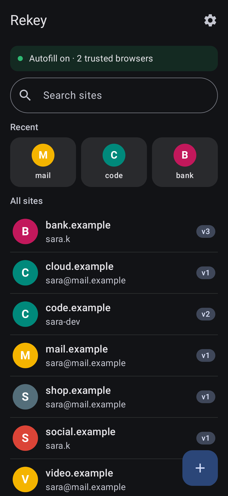
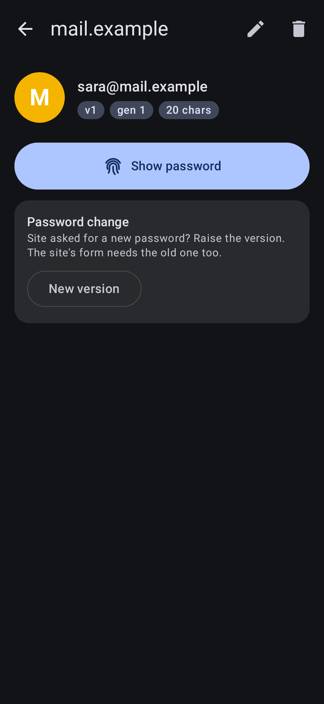
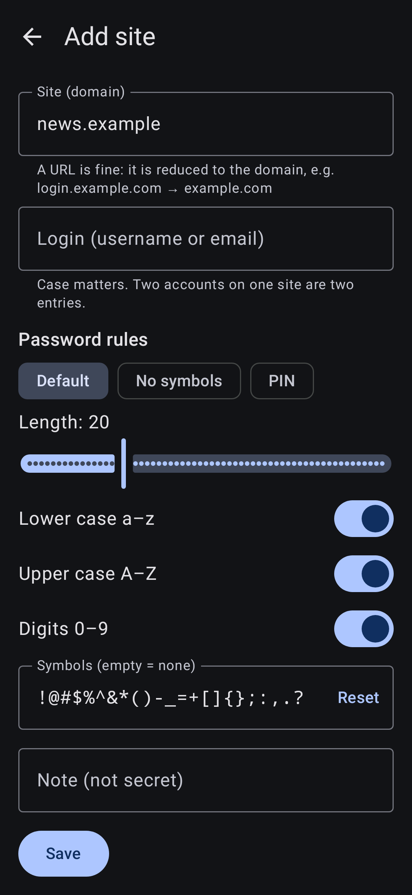
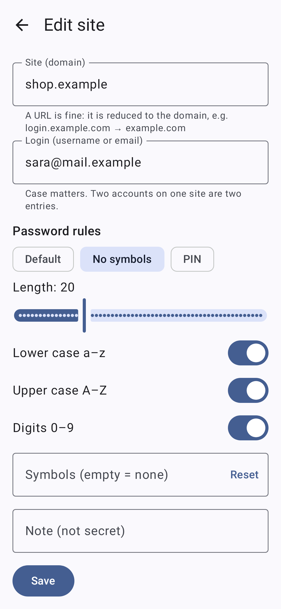

# Rekey

**Every password, none of them stored.** A strong, different password for every site and app, recomputed when you need it from a secret locked in your phone's secure hardware and opened by your fingerprint.

**[See the full page →](https://mohamed-ibrahim47.github.io/rekey-showcase/)** · **[Privacy policy](https://mohamed-ibrahim47.github.io/rekey-showcase/privacy.html)**

> The source code is private. This page shows what the app does and how it works.

## Screenshots

  
  
  
  

The app blocks screenshots on a phone, so these are its real screens rendered from the same code, with a made-up site list. No password appears in any of them.

## The idea

A password vault keeps every password, encrypted behind a master password. A master-password generator keeps nothing, but everything falls if someone guesses that one password.

Rekey keeps nothing secret either, and has no password to guess:

- The master is **128 random bits**, created on the phone and imported into the **Android Keystore** as a non-exportable key that needs a fingerprint for every use.
- It's shown once as **12 words** for a paper backup, then wiped from the app.
- Each password is `HMAC-SHA256(master, "rekey-v1" + site + login + version)` inside the secure hardware, stretched in software and mapped onto the allowed characters without bias.

The phone stores only a list of sites, logins, versions and rules. None of it is secret.

## What it does

- **Autofill that knows the site.** The page's domain is reduced to its registrable domain with a bundled public suffix list. Only a matching entry is offered, so a look-alike domain gets nothing.
- **Trusted browsers only.** Any app can claim its fields belong to a website, so a web domain counts only from a browser you confirmed once. Its signing certificate is pinned.
- **https only, one origin per fill.** Native apps are linked once and pinned to their signing certificate.
- **Password changes** by raising a site's version; the previous one stays one touch away.
- **Per-site rules**, **master generations** (move sites to a new master one at a time), **export/import**, and **restore from 12 words**.
- **No internet permission**, screenshots blocked, passwords wiped from memory when you leave the screen, clipboard cleared after 30 s.

## Hardened against other apps on your phone

- **Screen overlays.** If another app draws over Rekey, its buttons ignore the touch. On Android 12 and newer such overlays are hidden while Rekey is open.
- **Fake screens.** No other app can slip its own screen into Rekey's task and pose as Rekey.
- **App impersonation.** A linked app is tied to one entry and to the exact signature you confirmed. If the signature changes, filling stops until you link it again.
- **Imported lists.** App links that arrive in an imported file do nothing until you confirm each app on this phone.
- **Plain http.** A page that doesn't state https gets no fill at all.
- **Clear prompts.** When an app asks for a password, the fingerprint prompt names that app.
- **Rule changes.** Changing a site's password rules raises its version, so two rule sets never share the same underlying password.

## Warning: what Rekey can't protect against

No app is safe on a phone that is already compromised. Know these limits before you rely on it.

- **A rooted or malware-infected phone.** Software with full control of the phone can misuse a fingerprint touch.
- **A malicious keyboard or accessibility service.** It can read what is typed and shown, including your 12 words. Use only ones you trust.
- **A forced touch.** Someone who can make you touch the sensor can unlock a password.
- **The clipboard on Android 9.** Other apps can read a copied password before it is cleared. Prefer autofill there.
- **A fake browser you choose to trust.** Rekey shows the browser's package and where it was installed from. Check them before you confirm.
- **Phones that can't hold the secret in the chip.** There the secret is decrypted in the app's memory for a moment at each use. Settings shows which mode your phone uses.

## How it's built

- Kotlin + Jetpack Compose, Android 9 and newer.
- A pure-Kotlin `core` module holds the maths, tested against 56 frozen vectors and a reference implementation. The algorithm is frozen as `rekey-v1`.
- Android Keystore (StrongBox when available), with an AES-wrapped fallback for phones that can't import an HMAC key.

---

Made by [Mohamed Ibrahim](https://github.com/mohamed-ibrahim47)
